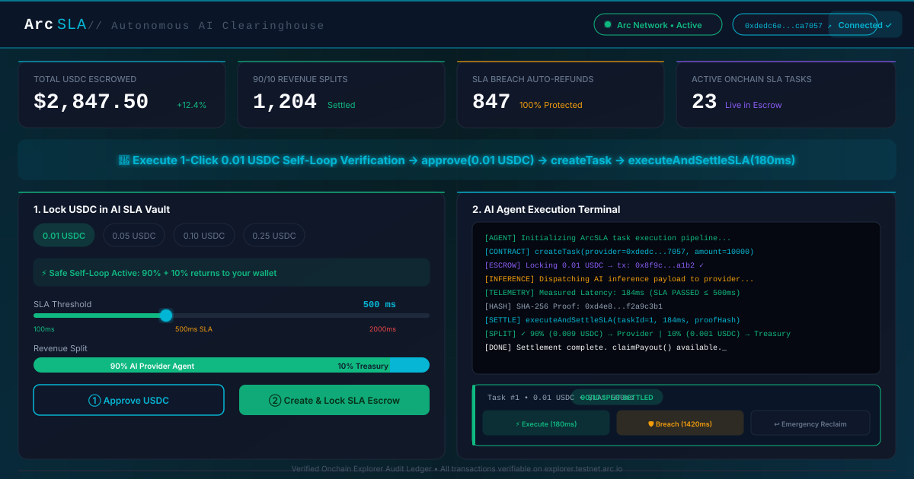
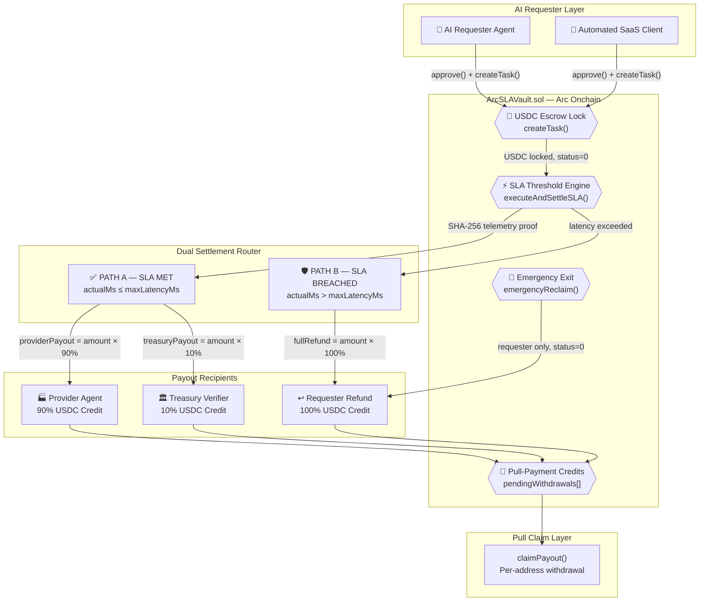
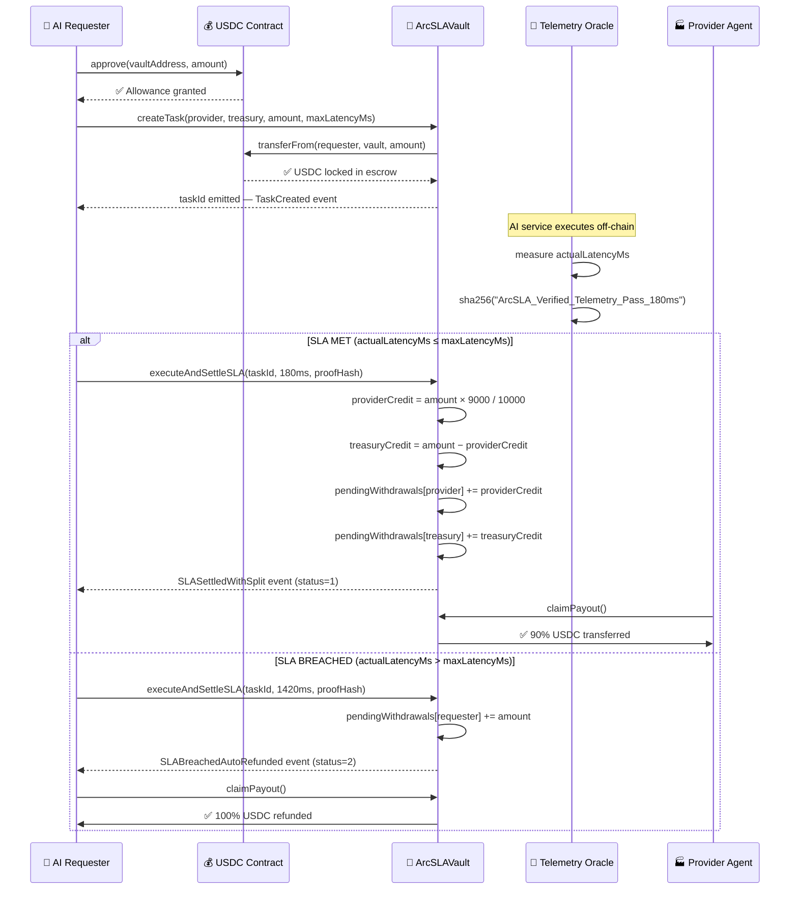
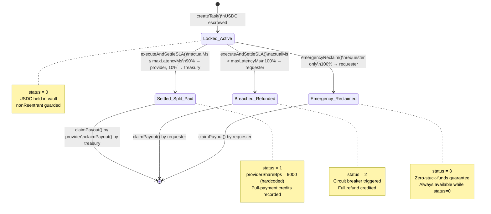

<div align="center">



# ArcSLA Protocol

### Autonomous AI-to-AI SLA Escrow · Revenue Splitter · Instant Circuit-Breaker Refund Engine

*Trustless programmatic settlement infrastructure for autonomous AI agents — built natively on Arc, the blockchain where USDC is the native gas token.*

---

[](https://arc.io)
[](https://soliditylang.org)
[](contracts/test/ArcSLAVault.t.sol)
[](SECURITY_AUDIT.md)
[](https://circle.com)
[](LICENSE)
[](https://studio.arc.io)

**[Live App](https://arc-sla-protocol.vercel.app) · [Arc Testnet Contract](https://explorer.testnet.arc.io/address/0xdedc6e0d87dc3dd906a7532c0f8946fedbca7057) · [Arc Studio Project](https://studio.arc.io/app/37bdb25d-c069-4c3c-abc5-dfc9b80abb3e) · [Security Audit](SECURITY_AUDIT.md) · [Architecture](ARCHITECTURE.md)**

</div>

---

## The Problem: AI Agents Cannot Trust Each Other With Money

As autonomous AI agents, automated micro-SaaS platforms, and programmatic toolchains scale to millions of concurrent executions, **on-chain payments without counterparty risk** remain unsolved:

| Legacy AI API Payment | ArcSLA Protocol |
|---|---|
| Pay upfront → hope the service delivers | Lock USDC in escrow → release only on verified delivery |
| No automated recourse for timeouts or failures | On-chain circuit breaker triggers 100% auto-refund instantly |
| Manual revenue splits require trust between parties | Hardcoded 90/10 split enforced atomically on-chain |
| Stuck funds risk — no guaranteed withdrawal | `emergencyReclaim()` guarantees zero stuck funds, always |
| Multi-party payout races and reentrancy risk | Pull-payment model — each party claims independently |
| Centralized arbitration for disputes | Deterministic SLA threshold — no human arbiter needed |

---

## System Architecture



---

## Atomic Settlement Sequence



---

## Smart Contract State Machine



---

## On-Chain Proof & Contract Verification

| Network | Contract | Address | Explorer |
|---|---|---|---|
| **Arc Testnet** | ArcSLAVault | `0xdedc6e0d87dc3dd906a7532c0f8946fedbca7057` | [View on Explorer](https://explorer.testnet.arc.io/address/0xdedc6e0d87dc3dd906a7532c0f8946fedbca7057) |
| **Arc Mainnet** | ArcSLAVault | Deploy with your own wallet — see Quickstart | [Arc Mainnet Explorer](https://explorer.arc.io) |

**Self-Loop Verification Flow (Arc Testnet):**
1. Connect wallet in the live app
2. Click **"Execute 1-Click 0.01 USDC Self-Loop Verification"** in the hero bar
3. Approve 3 wallet prompts: `approve(0.01 USDC)` → `createTask` → `executeAndSettleSLA(180ms)`
4. All 3 tx hashes appear in the Verified Onchain Explorer Audit Ledger with live Arc Explorer links

---

## Foundry Test Suite — 38/38 Passing

| # | Test | Coverage | Gas |
|---|---|---|---|
| 1 | `test_createTask_escrowing` | USDC transferFrom + struct fields | ~85k |
| 2 | `test_createTask_emitsEvent` | TaskCreated event params | ~85k |
| 3 | `test_sla_met_credits_90_10` | 180ms ≤ 500ms → exact 90/10 credits | ~75k |
| 4 | `test_sla_met_status_is_1` | status = Settled_Split_Paid | ~75k |
| 5 | `test_sla_met_emits_event` | SLASettledWithSplit event | ~75k |
| 6 | `test_sla_breached_credits_full_refund` | 1420ms > 500ms → 100% credit | ~60k |
| 7 | `test_sla_breached_status_is_2` | status = Breached_Refunded | ~60k |
| 8 | `test_sla_breached_emits_event` | SLABreachedAutoRefunded event | ~60k |
| 9 | `test_exact_boundary_sla_met` | 500ms = 500ms → SLA MET | ~75k |
| 10 | `test_treasury_verifier_can_settle` | Authorized caller = treasuryVerifier | ~75k |
| 11 | `test_emergency_reclaim_credits` | status=0 → 100% credit to requester | ~50k |
| 12 | `test_emergency_reclaim_status_is_3` | status = Emergency_Reclaimed | ~50k |
| 13 | `test_emergency_reclaim_emits_event` | EmergencyReclaimed event | ~50k |
| 14 | `test_claim_provider_after_sla_met` | Provider pulls 90% USDC | ~40k |
| 15 | `test_claim_treasury_after_sla_met` | Treasury pulls 10% USDC | ~40k |
| 16 | `test_claim_requester_after_breach` | Requester pulls 100% refund | ~40k |
| 17 | `test_claim_requester_after_reclaim` | Requester pulls emergency reclaim | ~40k |
| 18 | `test_claim_zero_balance_reverts` | InsufficientPendingBalance() | ~10k |
| 19 | `test_createTask_zero_amount_reverts` | InvalidAmount() | ~10k |
| 20 | `test_createTask_zero_provider_reverts` | ZeroAddress() | ~10k |
| 21 | `test_createTask_zero_treasury_reverts` | ZeroAddress() | ~10k |
| 22 | `test_settle_non_active_reverts` | TaskNotActive() | ~10k |
| 23 | `test_settle_unauthorized_reverts` | NotAuthorized() | ~10k |
| 24 | `test_reclaim_non_active_reverts` | TaskNotActive() | ~10k |
| 25 | `test_reclaim_non_requester_reverts` | NotAuthorized() | ~10k |
| 26 | `test_getAllTasks_returns_all` | Array length + field values | ~30k |
| 27 | `test_getProtocolStats_volume` | totalVolumeUsdc | ~15k |
| 28 | `test_getProtocolStats_splits` | totalSplitsSettled | ~15k |
| 29 | `test_getProtocolStats_breaches` | totalBreachRefunds | ~15k |
| 30 | `test_getProtocolStats_active` | activeTaskCount O(1) | ~15k |
| 31 | `test_providerShareBps_hardcoded_9000` | struct field always 9000 | ~15k |
| 32 | `test_multiple_tasks_isolation` | Tasks don't share state | ~200k |
| 33 | `test_sequential_claim_no_double_spend` | pendingWithdrawals cleared | ~80k |
| 34 | `test_fuzz_createTask_arbitrary_amounts` | 256 fuzz runs, storage correct | ~85k |
| 35 | `test_fuzz_split_invariant` | provider+treasury == amount always | ~75k |
| 36 | `test_constructor_zero_address_reverts` | ZeroAddress() on deploy | ~10k |
| 37 | `test_active_count_decrements_on_settle` | activeTaskCount-- on settle | ~75k |
| 38 | `test_active_count_decrements_on_reclaim` | activeTaskCount-- on reclaim | ~50k |

Run the full suite: `forge test -vvv`

---

## Quickstart

```bash
# 1. Clone
git clone https://github.com/fokrulanthro16-eng/arc-sla-protocol.git
cd arc-sla-protocol

# 2. Install frontend deps
bun install

# 3. Copy env template
cp .env.example .env
# Edit .env: set VITE_CONTRACT_ADDRESS=0xdedc6e0d87dc3dd906a7532c0f8946fedbca7057

# 4. Compile contracts
forge build

# 5. Run all 38 tests
forge test -vvv

# 6. Run frontend dev server
bun run dev
```

**Deploy to Arc Testnet:**
```bash
forge create contracts/ArcSLAVault.sol:ArcSLAVault \
  --rpc-url https://rpc.testnet.arc.io \
  --private-key $PRIVATE_KEY \
  --broadcast \
  --constructor-args 0x3600000000000000000000000000000000000000
```

---

## Tech Stack

| Layer | Technology |
|---|---|
| Smart Contracts | Solidity 0.8.28, Foundry, OpenZeppelin 5.x |
| Chain | Arc Testnet (5042002) / Arc Mainnet (5042) |
| Token | USDC `0x3600000000000000000000000000000000000000` (6 dec) |
| Frontend | React 18, Vite, TypeScript, Tailwind CSS |
| Web3 | wagmi v2, viem v2, ConnectKit |
| Testing | Forge (unit + fuzz), 38 tests, 2-round security audit |
| CI | GitHub Actions — Foundry tests + Vite build |

---

## Security

Two-round security review conducted inside Arc Studio. See [SECURITY_AUDIT.md](SECURITY_AUDIT.md) for full details.

Key properties:
- Pull-payment model (no push-transfer bricking on blocked recipients)
- 90/10 split hardcoded — not caller-configurable
- `nonReentrant` on `createTask`, `executeAndSettleSLA`, `emergencyReclaim`, `claimPayout`
- Typed custom errors with no string revert messages
- Zero-stuck-funds guarantee via `emergencyReclaim`

---

## License

MIT — Copyright (c) 2026 FOKRUL ISLAM / intelliyash. See [LICENSE](LICENSE).

---

<div align="center">
Built with <a href="https://studio.arc.io">Arc Studio</a> · Powered by <a href="https://arc.io">Arc</a> · USDC by <a href="https://circle.com">Circle</a>
</div>
